# TP : Event Driven Architecture avec Kafka, Spring Cloud Stream et Kafka Streams

**Réalisé par :** Badr Eddine TOUBANI
**Formation :** Master SDIA, ENSET Mohammedia
**Encadrant :** Pr. Mohamed YOUSSFI
**Références :** [vidéo du TP](https://www.youtube.com/watch?v=8uY7JE_X_Fw) et support de cours *Event Driven Architecture : JMS et KAFKA*

---

## Sommaire

1. [Environnement](#environnement)
2. [Structure du dépôt](#structure-du-dépôt)
3. [Partie 1 : Kafka en local (ZooKeeper + broker)](#partie-1--kafka-en-local-zookeeper--broker)
4. [Partie 2 : cluster Kafka avec Docker](#partie-2--cluster-kafka-avec-docker)
5. [Partie 3 : Spring Cloud Stream et Kafka Streams](#partie-3--spring-cloud-stream-et-kafka-streams)
6. [Relancer le projet](#relancer-le-projet)
7. [Conclusion](#conclusion)

---

## Environnement

| Élément | Version |
|---|---|
| Machine | MacBook (Apple Silicon, arm64), macOS 27 |
| Java | Temurin 21.0.11 |
| Maven | 3.9.16 |
| Apache Kafka (binaire) | 3.9.1 (Scala 2.13), dernière ligne qui fonctionne encore avec ZooKeeper |
| Docker / Docker Compose | 29.5 / v5.1 |
| Images Docker | `confluentinc/cp-zookeeper:7.9.0`, `confluentinc/cp-kafka:7.9.0` |
| Spring Boot / Spring Cloud | 3.5.16 / 2025.0.3 |

> **Remarque :** Kafka 4.x a supprimé ZooKeeper (mode KRaft uniquement). Le TP demande de démarrer ZooKeeper, d'où le choix de Kafka **3.9.1** pour le binaire et de Confluent Platform **7.9.0** pour Docker.

## Structure du dépôt

```
tp-kafka/
├── README.md                       ← ce rapport
├── captures/                       ← captures d'écran de chaque étape
├── partie1-kafka-local/            ← Kafka 3.9.1 téléchargé et décompressé
├── partie2-docker/
│   └── docker-compose.yml          ← cluster 3 ZooKeeper + 3 brokers
├── kafka-spring-cloud-streams/     ← projet Spring Boot (partie 3)
│   ├── pom.xml
│   └── src/main/
│       ├── java/ma/enset/kafka/
│       │   ├── KafkaSpringCloudStreamsApplication.java
│       │   ├── events/PageEvent.java
│       │   ├── handlers/PageEventHandler.java      ← Consumer, Supplier, Function, Kafka Streams
│       │   └── web/PageEventRestController.java    ← Producer REST + SSE /analytics
│       └── resources/
│           ├── application.properties
│           └── static/index.html                   ← tableau de bord temps réel
└── .tools/                         ← scripts de capture + sorties brutes des commandes (logs/)
```

---

## Partie 1 : Kafka en local (ZooKeeper + broker)

### 1.1 Télécharger Kafka

On télécharge l'archive binaire de Kafka 3.9.1, puis on la décompresse. Le dossier `bin/` contient les scripts de démarrage (`zookeeper-server-start.sh`, `kafka-server-start.sh`) et les outils console (`kafka-topics.sh`, `kafka-console-producer.sh`, `kafka-console-consumer.sh`).

```bash
curl -O https://archive.apache.org/dist/kafka/3.9.1/kafka_2.13-3.9.1.tgz
tar -xzf kafka_2.13-3.9.1.tgz
```

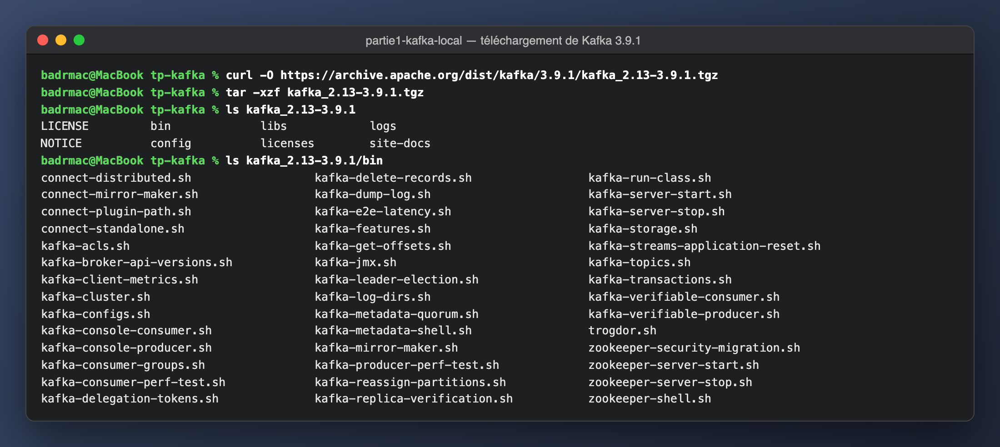

### 1.2 Démarrer ZooKeeper

ZooKeeper conserve l'état du cluster (brokers vivants, contrôleur, métadonnées des topics). Il démarre en mode *standalone* et écoute sur le port **2181**.

```bash
cd partie1-kafka-local/kafka_2.13-3.9.1
bin/zookeeper-server-start.sh config/zookeeper.properties
```

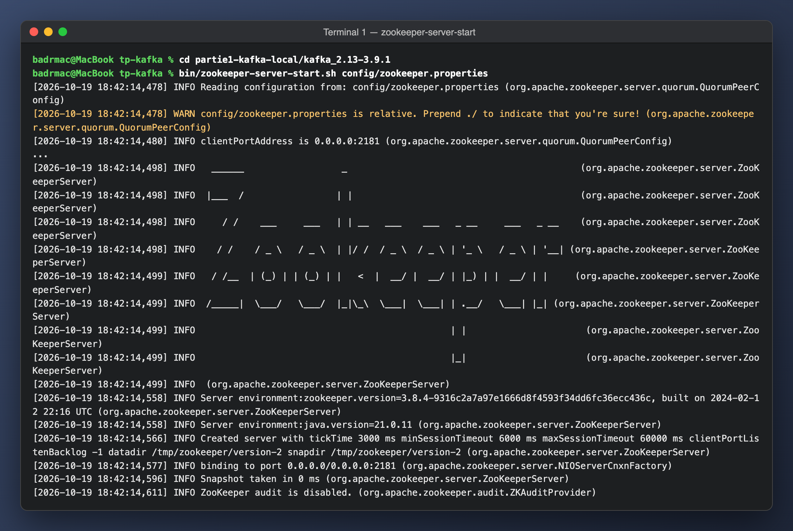

### 1.3 Démarrer le serveur Kafka

Dans un deuxième terminal, on lance le broker. Il se connecte à ZooKeeper (`localhost:2181`), puis accepte les connexions des clients sur le port **9092**. La ligne `[KafkaServer id=0] started` confirme que le démarrage a réussi.

```bash
bin/kafka-server-start.sh config/server.properties
```

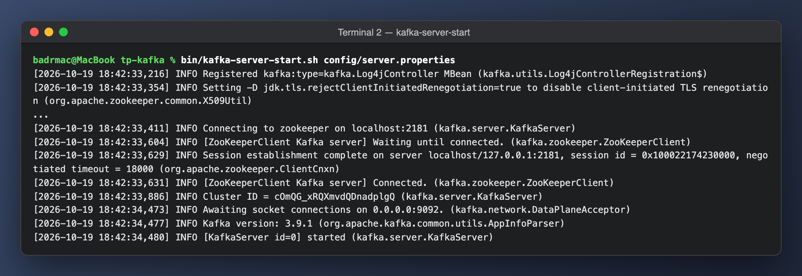

### 1.4 Créer un topic

```bash
bin/kafka-topics.sh --create --bootstrap-server localhost:9092 --replication-factor 1 --partitions 1 --topic test
bin/kafka-topics.sh --list --bootstrap-server localhost:9092
bin/kafka-topics.sh --describe --bootstrap-server localhost:9092 --topic test
```

> Depuis Kafka 3.0, l'option `--zookeeper` du support (Kafka 2.3) n'existe plus pour `kafka-topics.sh`. On utilise `--bootstrap-server`.

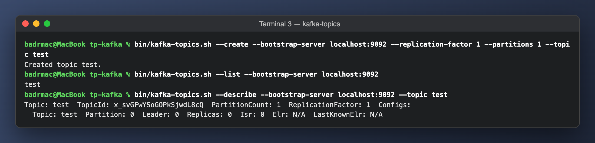

### 1.5 Tester avec kafka-console-producer et kafka-console-consumer

On ouvre deux terminaux. À gauche, le **producer** envoie chaque ligne saisie dans le topic `test`. À droite, le **consumer** (`--from-beginning`) affiche les messages au fur et à mesure qu'ils arrivent.

```bash
# Terminal 3
bin/kafka-console-producer.sh --bootstrap-server localhost:9092 --topic test
# Terminal 4
bin/kafka-console-consumer.sh --bootstrap-server localhost:9092 --topic test --from-beginning
```

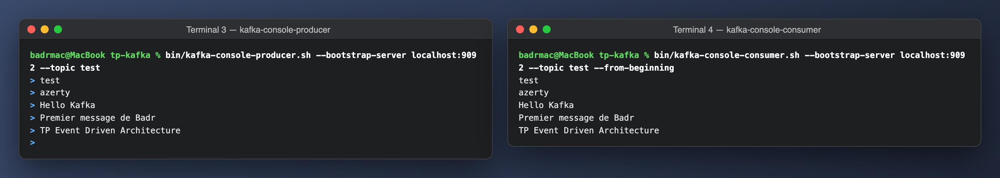

Tous les messages saisis côté producer apparaissent côté consumer, dans le même ordre (une seule partition).

---

## Partie 2 : cluster Kafka avec Docker

### 2.1 Le fichier `docker-compose.yml`

Comme dans le support de cours, on démarre un **cluster de 6 conteneurs** :
- **3 nœuds ZooKeeper** formant un *ensemble* (ports clients 12181, 22181 et 32181) ;
- **3 brokers Kafka** (`kafka-1`, `kafka-2`, `kafka-3`) exposés sur l'hôte via les ports 19092, 29092 et 39092.

Le fichier complet se trouve dans [`partie2-docker/docker-compose.yml`](partie2-docker/docker-compose.yml). Extrait pour un broker :

```yaml
  kafka-1:
    image: confluentinc/cp-kafka:7.9.0
    hostname: kafka-1
    ports:
      - "19092:19092"
    depends_on: [zookeeper-1, zookeeper-2, zookeeper-3]
    environment:
      KAFKA_BROKER_ID: 1
      KAFKA_ZOOKEEPER_CONNECT: zookeeper-1:12181,zookeeper-2:22181,zookeeper-3:32181
      KAFKA_LISTENERS: INTERNAL://0.0.0.0:9092,EXTERNAL://0.0.0.0:19092
      KAFKA_ADVERTISED_LISTENERS: INTERNAL://kafka-1:9092,EXTERNAL://localhost:19092
      KAFKA_LISTENER_SECURITY_PROTOCOL_MAP: INTERNAL:PLAINTEXT,EXTERNAL:PLAINTEXT
      KAFKA_INTER_BROKER_LISTENER_NAME: INTERNAL
```

**Corrections apportées au fichier du support.** Sans elles, le cluster ne démarre pas ou reste inaccessible depuis l'hôte :

| Problème dans le support | Correction |
|---|---|
| `image: confluentinc/cp-kafka:latest` : la version actuelle (8.x) ne fonctionne plus qu'en mode KRaft et refuse ZooKeeper | Images épinglées en `7.9.0` |
| `KAFKA_ZOOKEEPER_CONNECT: zookeeper-1:12181,zookeeper-2:12181,zookeeper-3:12181` alors que zookeeper-2 écoute sur 22181 et zookeeper-3 sur 32181 | `zookeeper-1:12181,zookeeper-2:22181,zookeeper-3:32181` |
| `KAFKA_ADVERTISED_LISTENERS: PLAINTEXT://kafka-1:19092` : un client lancé sur l'hôte (l'application Spring Boot) reçoit le nom `kafka-1`, qu'il ne sait pas résoudre | Deux listeners : `INTERNAL` (`kafka-N:9092`) pour les échanges entre brokers et `EXTERNAL` (`localhost:N9092`) pour les clients de l'hôte |

### 2.2 Démarrer les conteneurs

```bash
cd partie2-docker
docker compose up -d
docker compose ps
```

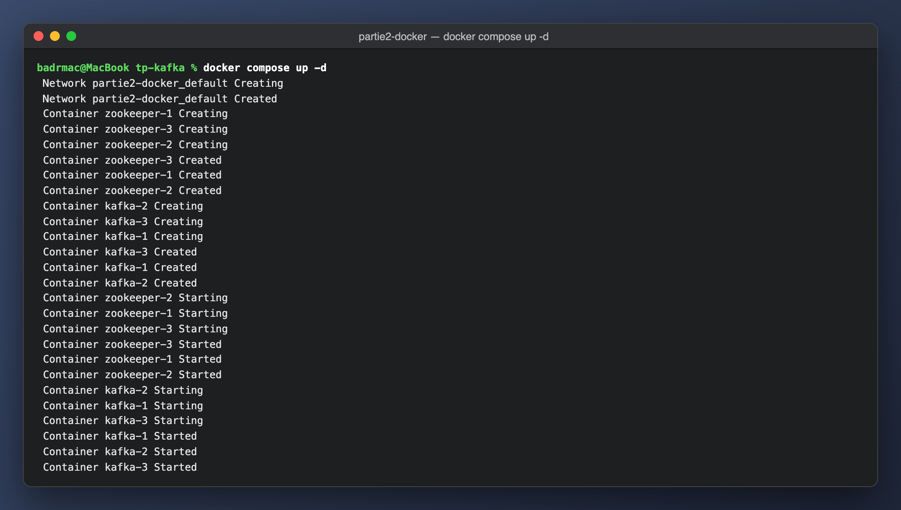

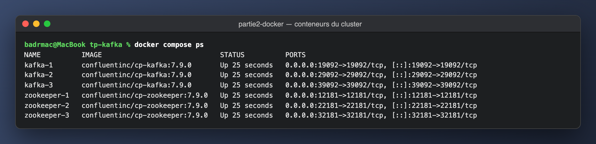

### 2.3 Vérifier le cluster

Les trois brokers sont enregistrés dans ZooKeeper (`/brokers/ids = [1, 2, 3]`). Les trois nœuds ZooKeeper forment bien un ensemble, avec un **leader** et deux **followers**.

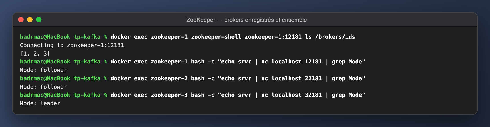

### 2.4 Créer un topic répliqué

On crée un topic de 3 partitions avec un facteur de réplication de 3. Chaque partition a un leader différent, et ses répliques sont réparties sur les 3 brokers (`Isr` = répliques synchronisées).

```bash
docker exec kafka-1 kafka-topics --bootstrap-server kafka-1:9092 --create --topic my-replicated-topic --partitions 3 --replication-factor 3
docker exec kafka-1 kafka-topics --bootstrap-server kafka-1:9092 --describe --topic my-replicated-topic
```

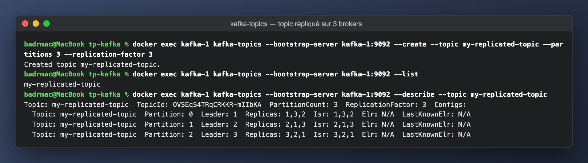

### 2.5 Tester avec kafka-console-producer et kafka-console-consumer

Le producer est connecté à `kafka-1` et le consumer à `kafka-2`. Les messages circulent d'un broker à l'autre à travers le cluster.

```bash
docker exec -it kafka-1 kafka-console-producer --bootstrap-server kafka-1:9092 --topic my-replicated-topic
docker exec -it kafka-2 kafka-console-consumer --bootstrap-server kafka-2:9092 --topic my-replicated-topic --from-beginning
```

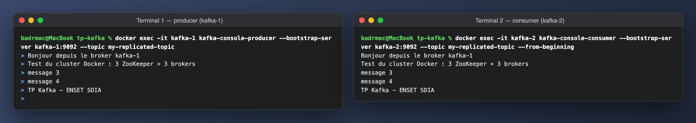

### 2.6 Tester la tolérance aux pannes

Ce test reprend celui du support. On arrête `kafka-1`, qui était leader de la partition 0 :
- la partition 0 élit un nouveau leader (broker 3), et le broker 1 sort de l'ISR ;
- un consumer connecté à `kafka-3` relit **les 5 messages** : aucune donnée n'est perdue.

> Le `TimeoutException` affiché à la fin est normal : il signale seulement la fin de l'option `--timeout-ms 8000`.

```bash
docker stop kafka-1
docker exec kafka-2 kafka-topics --bootstrap-server kafka-2:9092 --describe --topic my-replicated-topic
docker exec kafka-3 kafka-console-consumer --bootstrap-server kafka-3:9092 --topic my-replicated-topic --from-beginning --timeout-ms 8000
```

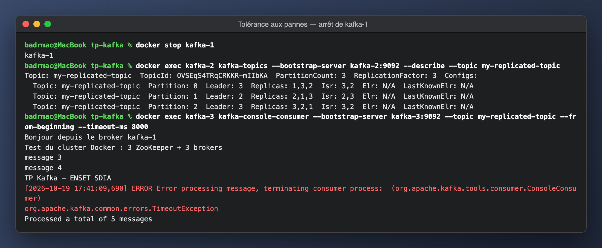

Au redémarrage de `kafka-1`, le broker se resynchronise et revient dans l'ISR de chaque partition :

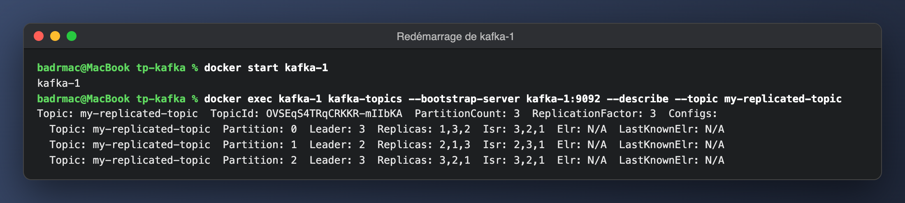

---

## Partie 3 : Spring Cloud Stream et Kafka Streams

### 3.1 Architecture

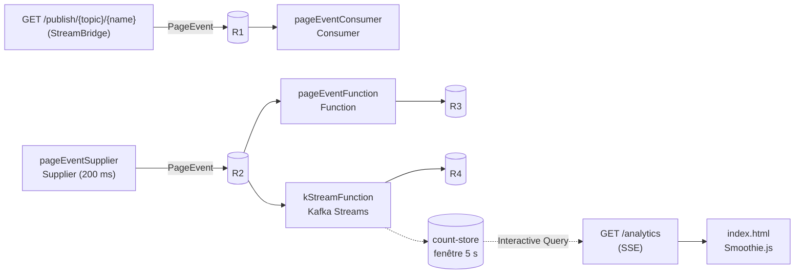

| Composant | Rôle | Topics |
|---|---|---|
| `PageEventRestController.publish` | **Producer** : publie un `PageEvent` via une API REST | → topic choisi dans l'URL |
| `pageEventConsumer` | **Consumer** : affiche les événements reçus | R1 → |
| `pageEventSupplier` | **Supplier** : génère un événement aléatoire toutes les 200 ms | → R2 |
| `pageEventFunction` | **Function** : consomme, transforme puis republie | R2 → R3 |
| `kStreamFunction` | **Kafka Streams** : analytics en temps réel (comptage par page sur une fenêtre de 5 s) | R2 → R4 + store `count-store` |
| `PageEventRestController.analytics` | Interroge le store chaque seconde et pousse le résultat en SSE | `/analytics` |
| `index.html` | **Application web** : graphique temps réel | |

### 3.2 Dépendances (`pom.xml`)

Spring Web, Spring for Apache Kafka, Kafka Streams, Spring Cloud Stream, les binders `spring-cloud-stream-binder-kafka` et `spring-cloud-stream-binder-kafka-streams`, ainsi que `reactor-core` pour le `Flux` du SSE.

### 3.3 L'événement

```java
public record PageEvent(String name, String user, Date date, long duration) { }
```

### 3.4 Producer KAFKA via un RestController

`StreamBridge` permet de publier dans n'importe quel topic depuis du code impératif :

```java
@GetMapping("/publish/{topic}/{name}")
public PageEvent publish(@PathVariable String topic, @PathVariable String name) {
    PageEvent pageEvent = new PageEvent(name, Math.random() > 0.5 ? "U1" : "U2",
            new Date(), new Random().nextInt(9000));
    streamBridge.send(topic, pageEvent);
    return pageEvent;
}
```

### 3.5 Consumer, Supplier, Function et Kafka Streams

```java
@Bean
public Consumer<PageEvent> pageEventConsumer() {
    return input -> {
        System.out.println("**********************");
        System.out.println("Message reçu : " + input);
        System.out.println("**********************");
    };
}

@Bean
public Supplier<PageEvent> pageEventSupplier() {
    return () -> new PageEvent(Math.random() > 0.5 ? "P1" : "P2",
            Math.random() > 0.5 ? "U1" : "U2", new Date(), new Random().nextInt(9000));
}

@Bean
public Function<PageEvent, PageEvent> pageEventFunction() {
    return input -> new PageEvent("L:" + input.name().length(), "UUUUUU", input.date(), input.duration());
}

@Bean
public Function<KStream<String, PageEvent>, KStream<String, Long>> kStreamFunction() {
    return input -> input
            .filter((k, v) -> v.duration() > 100)                         // visites de plus de 100 ms
            .map((k, v) -> new KeyValue<>(v.name(), v.duration()))       // clé = nom de la page
            .groupByKey(Grouped.with(Serdes.String(), Serdes.Long()))
            .windowedBy(TimeWindows.ofSizeWithNoGrace(Duration.ofSeconds(5)))
            .count(Materialized.as("count-store"))                       // store interrogeable
            .toStream()
            .map((k, v) -> new KeyValue<>(k.key(), v));
}
```

> `TimeWindows.of(...)`, utilisé dans la vidéo, est déprécié depuis Kafka 3.0. On utilise `TimeWindows.ofSizeWithNoGrace(...)` à la place.

### 3.6 Configuration (`application.properties`)

```properties
spring.cloud.stream.kafka.binder.brokers=localhost:19092,localhost:29092,localhost:39092
spring.cloud.stream.kafka.streams.binder.brokers=localhost:19092,localhost:29092,localhost:39092
spring.cloud.stream.kafka.binder.replication-factor=3

spring.cloud.function.definition=pageEventConsumer;pageEventSupplier;pageEventFunction;kStreamFunction

spring.cloud.stream.bindings.pageEventConsumer-in-0.destination=R1
spring.cloud.stream.bindings.pageEventSupplier-out-0.destination=R2
spring.cloud.stream.poller.fixed-delay=200
spring.cloud.stream.bindings.pageEventFunction-in-0.destination=R2
spring.cloud.stream.bindings.pageEventFunction-out-0.destination=R3
spring.cloud.stream.bindings.kStreamFunction-in-0.destination=R2
spring.cloud.stream.bindings.kStreamFunction-out-0.destination=R4
spring.cloud.stream.kafka.streams.binder.functions.kStreamFunction.applicationId=tp-kafka-analytics
spring.cloud.stream.kafka.streams.binder.configuration.commit.interval.ms=1000
```

L'application se connecte au **cluster Docker de la partie 2**. Les topics qu'elle crée sont répliqués sur les 3 brokers.

### 3.7 Compilation et démarrage

```bash
cd kafka-spring-cloud-streams
mvn clean package -DskipTests
java -jar target/kafka-spring-cloud-streams-1.0.0.jar
```

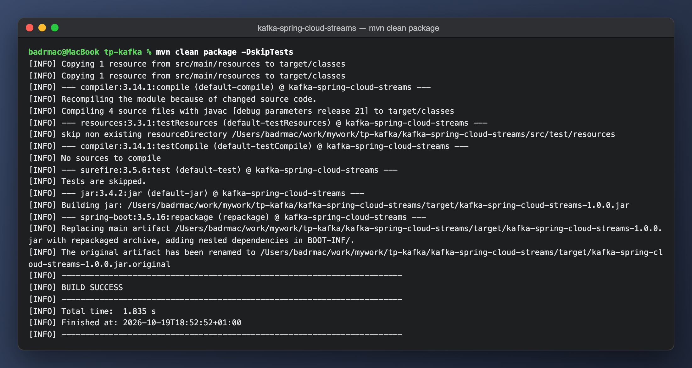

Au démarrage, Tomcat écoute sur le port 8080, puis les consumers `tp-function` (R2) et `tp-consumer` (R1) reçoivent leurs partitions. Enfin, Kafka Streams passe à l'état **RUNNING**.

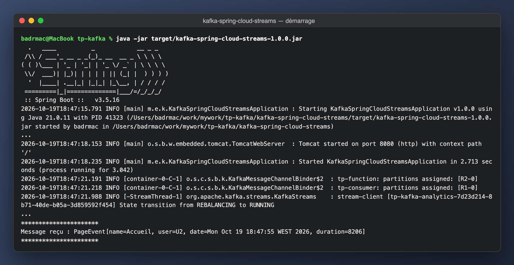

L'application a créé les topics R1 à R4, ainsi que les topics internes de Kafka Streams (`*-repartition` et `*-changelog`). R2 a un facteur de réplication de 3 :

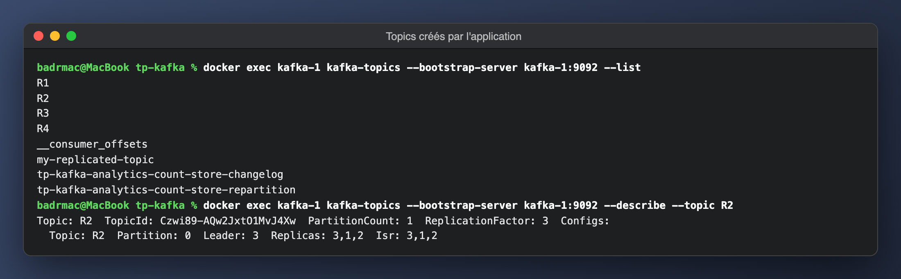

### 3.8 Test du Producer REST

Appel de `GET /publish/R1/{name}` : l'API renvoie l'événement publié.

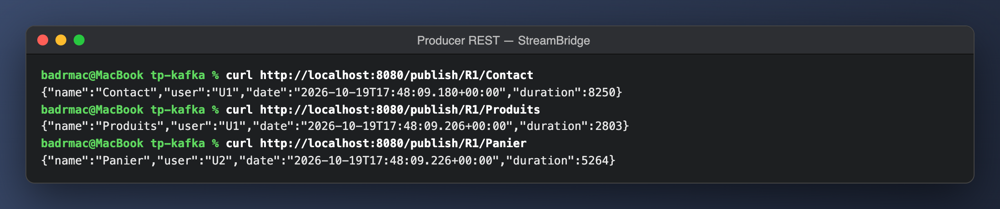

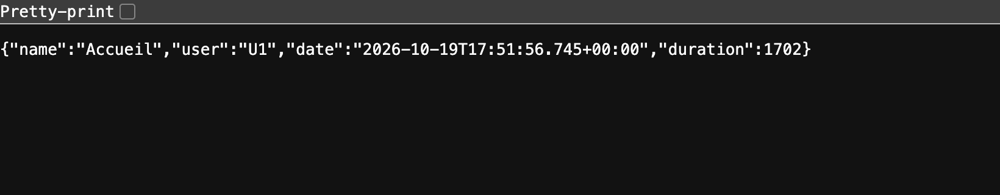

### 3.9 Test du Consumer

Chaque événement publié dans R1 est reçu et affiché par `pageEventConsumer` dans la console de l'application :

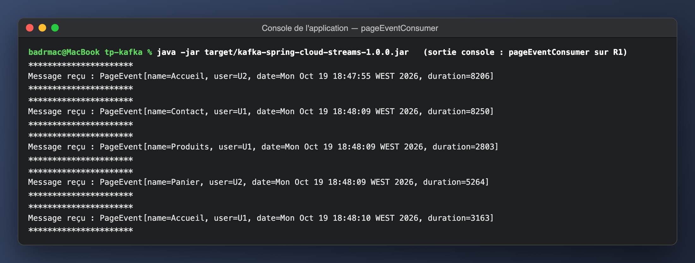

### 3.10 Test du Supplier

Le Supplier publie un `PageEvent` aléatoire dans R2 toutes les 200 ms (voir les horodatages) :

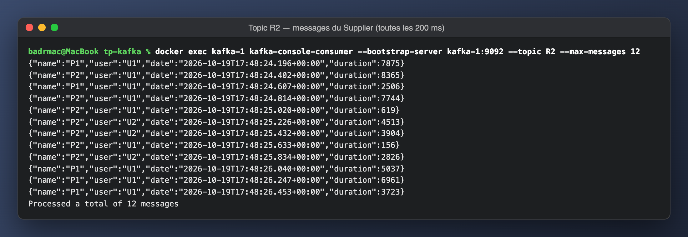

### 3.11 Test de la Function

`pageEventFunction` lit R2 et publie dans R3 l'événement transformé (`name = "L:" + longueur du nom`, `user = "UUUUUU"`) :

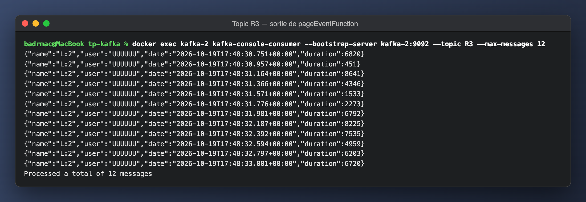

### 3.12 Real Time Stream Processing avec Kafka Streams

R4 reçoit, pour chaque page, le nombre de visites (de plus de 100 ms) dans la fenêtre de 5 secondes en cours. La valeur augmente au fil de la fenêtre, puis repart de 1 quand une nouvelle fenêtre commence. On lit R4 avec `LongDeserializer` :

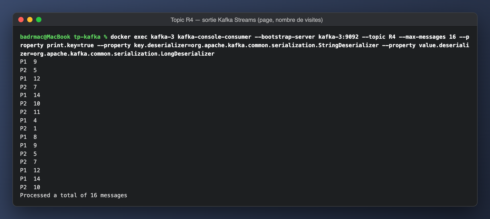

L'endpoint `/analytics` interroge le state store `count-store` chaque seconde (*Interactive Query*) et diffuse le résultat en **Server-Sent Events** :

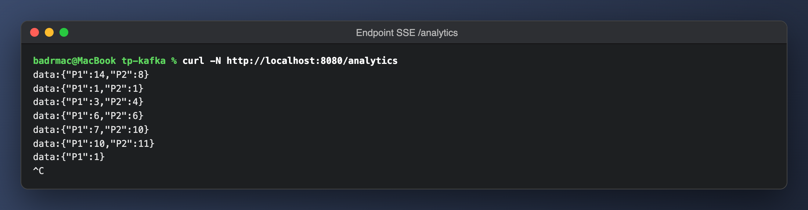

### 3.13 Application web : résultats en temps réel

La page `http://localhost:8080/` s'abonne au flux SSE avec `EventSource` et trace une courbe par page avec **Smoothie.js**. Les cartes affichent la valeur courante de chaque page. Une nouvelle page apparaît automatiquement dès qu'elle arrive dans le flux. Sur la capture, la page **P3** a été publiée dans R2 via l'API REST (`/publish/R2/P3`) pendant que le Supplier produisait P1 et P2.

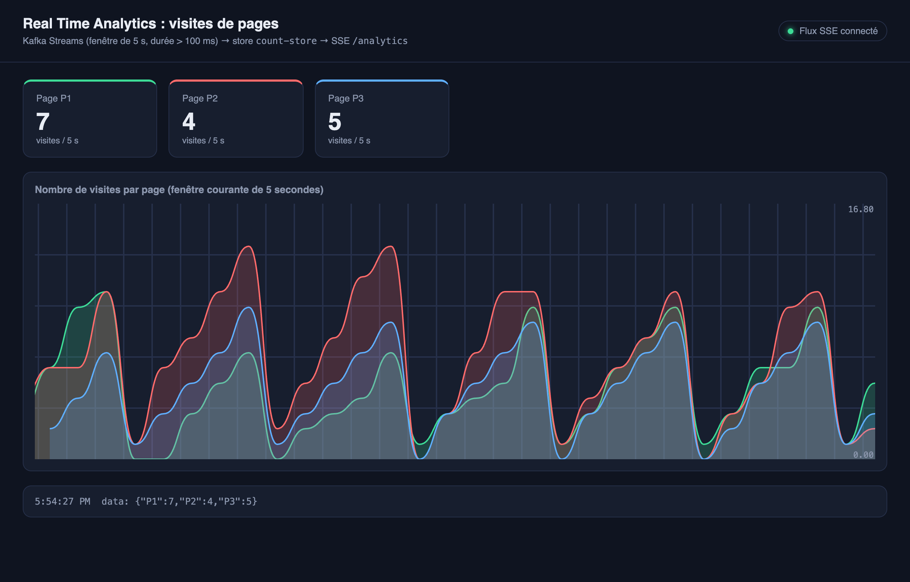

La courbe en dents de scie reflète la fenêtre *tumbling* de 5 secondes : le compteur augmente pendant la fenêtre, puis repart de zéro à la fenêtre suivante.

---

## Relancer le projet

```bash
# 1. Cluster Kafka
cd partie2-docker && docker compose up -d

# 2. Application Spring (Java 21)
cd ../kafka-spring-cloud-streams
mvn clean package -DskipTests
java -jar target/kafka-spring-cloud-streams-1.0.0.jar

# 3. Navigateur
open http://localhost:8080/                       # tableau de bord
curl http://localhost:8080/publish/R1/Accueil     # producer REST -> consumer
curl http://localhost:8080/publish/R2/P3          # alimente l'analytics

# Arrêt
docker compose -f partie2-docker/docker-compose.yml down
```

Pour utiliser le broker local de la partie 1 à la place du cluster :
`KAFKA_BROKERS=localhost:9092 KAFKA_REPLICATION=1 java -jar target/kafka-spring-cloud-streams-1.0.0.jar`

> **Captures :** chaque capture de terminal est générée par `.tools/term.js` à partir de la sortie réelle de la commande, enregistrée dans `.tools/logs/`. Les captures du navigateur sont prises sur l'application en cours d'exécution, avec Chrome en mode headless (`.tools/shot.js`).

## Conclusion

Ce TP a permis de mettre en place une architecture orientée événements complète :
- Kafka installé en local, puis en **cluster Docker** (3 ZooKeeper + 3 brokers), avec un test réel de **tolérance aux pannes** : la perte d'un broker ne fait perdre aucun message grâce à la réplication ;
- le modèle **fonctionnel** de Spring Cloud Stream (`Supplier`, `Consumer`, `Function`), qui découple le code métier de Kafka (les topics sont déclarés uniquement dans la configuration) ;
- un traitement **temps réel** avec Kafka Streams (filtrage, regroupement, fenêtrage, agrégation), dont le résultat est stocké dans un state store interrogeable et poussé vers le navigateur en SSE.
